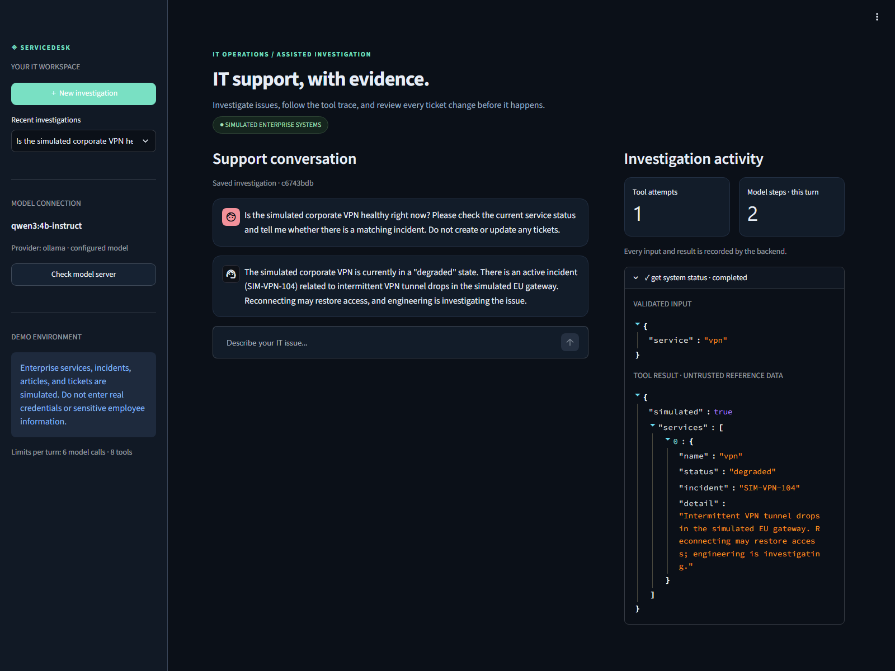
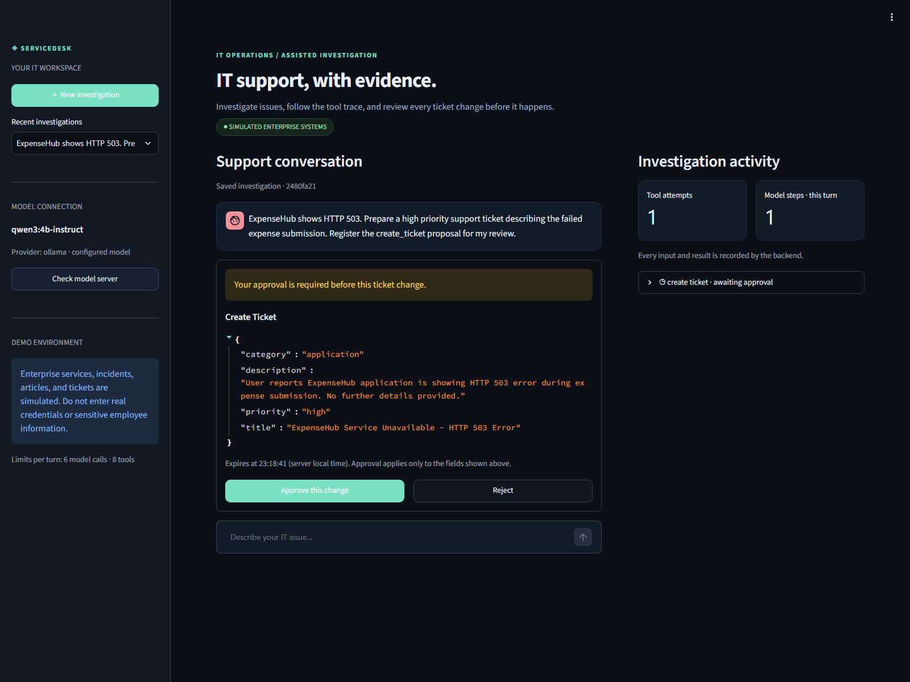
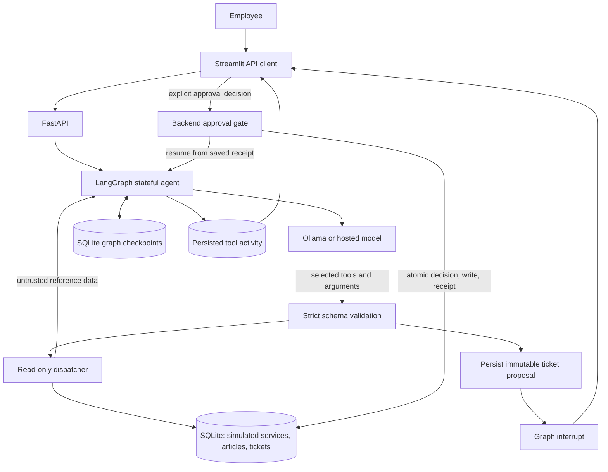
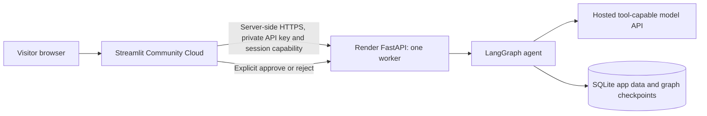

# ServiceDesk · AI IT Support Agent

An IT support assistant that uses an LLM to investigate problems, inspect service health, retrieve troubleshooting guidance, and prepare tickets. **The model chooses the tools. The backend enforces approval before ticket changes.**

Built with Python, LangGraph, FastAPI, Streamlit, SQLite, and Ollama. It runs locally and includes a separate Streamlit Community Cloud / Render deployment profile. It exposes the evidence behind each answer; durable recovery requires persistent storage. Enterprise services and ticket data are **simulated**; model responses are generated through the configured provider. There is no canned-answer fallback.

[Cloud deployment](#cloud-deployment) · [Local setup](#local-setup) · [Architecture](#architecture) · [Verified testing](#testing-and-verified-results) · [Two-minute demo](docs/demo.md) · [QA report](docs/qa-report.md)

## Key features

- **Dynamic tool calling:** a bounded LangGraph model → tools → model loop, using five validated tool schemas.
- **Human approval:** create/update proposals pause execution; a dedicated API decision commits only the reviewed fields.
- **Durable investigations:** conversation history, tool activity, approvals, and graph checkpoints persist in SQLite.
- **Visible evidence:** chat beside an activity panel with actual tool arguments, results, and execution status.
- **Failure handling:** explicit notices for unavailable providers, timeouts, invalid model output, and exhausted budgets.
- **Reproducible demo:** locked dependencies and deterministic fixtures for VPN, Wi-Fi, email, DNS, account access, and application connectivity.

## Screenshots

Screenshot provenance and capture instructions are documented in [the demo guide](docs/demo.md#screenshots). Only actual application captures belong here; generated mockups are not used as execution evidence.





Captured from the running app on November 18, 2026 with actual `qwen3:4b-instruct` state and synthetic data. [Capture provenance and verification scope](docs/portfolio-verification.md).

## Tech stack

| Layer | Implementation |
| --- | --- |
| Orchestration | LangGraph `StateGraph`, SQLite checkpoints, `interrupt` / `Command` |
| Backend | FastAPI, Pydantic, HTTPX |
| Frontend | Streamlit; calls FastAPI for all agent and ticket operations |
| Persistence | SQLite application database and a separate checkpoint database |
| Inference | Ollama native `/api/chat`; optional hosted OpenAI-compatible Chat Completions |
| Verification | Pytest, Streamlit AppTest, Ruff, opt-in real-model smoke/QA scripts |
| Local packaging | `uv.lock`, Dockerfile, Docker Compose, GitHub Actions workflow |

## Architecture



The LLM selects tools and follow-up actions. Graph edges enforce execution limits and approval boundaries; they do not classify issues by keywords. Troubleshooting lookup is a structured SQLite category query with deterministic symptom-term ranking. This project does not use embeddings, RAG, a vector database, MCP, or shell access.

### Agent execution lifecycle

1. FastAPI validates the user message and loads the saved conversation/checkpoint.
2. The model receives the system instructions, history, and tool schemas.
3. If it requests tools, the backend validates their names and narrow arguments, then checks the remaining budget.
4. Read tools execute and their results are recorded as **untrusted reference data**, then returned to the model.
5. A ticket tool persists an immutable proposal and interrupts the graph. Chat “yes” cannot authorize a write.
6. The user reviews the exact arguments and clicks **Approve this change** or **Reject**. FastAPI validates the proposal, expiry, conversation, and ticket version.
7. Approval decision, ticket change, and execution receipt commit in one transaction. Rejection changes no ticket. The graph resumes with the recorded outcome and the model produces its response.
8. State and activity remain available after a restart. A recoverable interrupted run can resume from its receipt without repeating the committed ticket write.

### Agent tools

| Tool | Validated input | Result / approval |
| --- | --- | --- |
| `get_system_status` | One supported service or `all` | Simulated health and incident records; read-only |
| `lookup_troubleshooting_steps` | Category, short query, limit 1–5 | Structured steps and escalation criteria; read-only |
| `get_ticket` | Positive integer ticket ID | Ticket, notes, and version, or a not-found result; read-only |
| `create_ticket` | Title, description, category, priority | Proposal; creates a ticket only after backend-validated approval |
| `update_ticket` | Ticket ID; status, priority, and/or note | Proposal; version-checked update only after approval |

## Cloud deployment

A low-cost deployment profile is prepared for **Streamlit Community Cloud → Render FastAPI → hosted Chat Completions**. It does not require Ollama on your computer. See the [complete deployment guide](docs/deployment.md), [Groq/Render diagnostics](docs/groq-diagnostics.md), and [readiness audit / verification](docs/deployment-audit.md).



- `render.yaml` defines a **Free** backend using `Dockerfile.backend`; `python -m support_agent.serve` binds to `0.0.0.0:$PORT`. `/healthz` is a lightweight public liveness check.
- Deploy the frontend entrypoint **`frontend/app.py`**, Python **3.13**. Its adjacent `requirements.txt` installs only frontend dependencies. Set `API_BASE_URL` and the shared `SUPPORT_API_KEY` in Streamlit's private root-level Secrets editor.
- The backend uses `APP_MODE=cloud` and `LLM_PROVIDER=openai` (the compatible Chat Completions adapter). The prepared hosted candidate is **Groq `openai/gpt-oss-20b`**, at `https://api.groq.com/openai/v1`. Store the provider key as Render's `OPENAI_API_KEY`, never in the frontend.
- Groq documents sequential function-tool calling for this model. **Actual hosted inference remains unverified** until an owner-provided key is used. Model/account availability, free quotas, and continued zero cost are not guaranteed. [Groq tool support](https://console.groq.com/docs/tool-use/overview), [rate limits](https://console.groq.com/docs/rate-limits).
- **Free Render storage is disposable.** The prepared profile explicitly sets `RESET_DEMO_ON_START=true`: each boot gets a fresh paired application/checkpoint database sandbox, leaving configured legacy files untouched. Old proposals cannot be applied after reset, and the frontend detects a new boot and starts a clean investigation. SQLite tickets and local usage counters are intentionally discarded; no durability is claimed. The UI displays a warning. Paid Render compute plus a persistent disk can preserve both database files; it requires billing approval and a restart test. Free Render Postgres expires after 30 days and is not a permanent solution. [Render limits](https://render.com/docs/free).
- Protected mode adds server API authentication, isolated visitor conversations/tickets, read-only shared sample ticket 1, request/body/conversation limits, one active investigation, and a global daily model-call budget. It retains backend-enforced approval, atomic receipts, and replay protection. This is a synthetic demo with capability-based sandboxes, not employee identity/RBAC or bot-proof access control.

Local preparation tests do not establish cloud success. Real keys belong only in hosting-provider secret settings. The actual public frontend, Render backend, hosted tool/result round trip, and explicitly approved ticket workflow must all pass the [deployment acceptance steps](docs/deployment.md#owner-step-4-verify-real-inference-and-the-public-approval-workflow) before claiming deployment. No cloud resources or credentials were provisioned during preparation.

## Local setup

Run commands from the repository root. Requirements: Linux/Ubuntu/WSL, Python 3.11–3.14 (3.13 recommended), and [uv](https://docs.astral.sh/uv/getting-started/installation/). The lockfile fixes Python package versions; model weights require a separate download.

```bash
git clone git@github.com:SaadAlamDev/it-support-agent.git
cd it-support-agent
uv sync --frozen --extra dev --python 3.13
cp .env.example .env
```

Copy `.env.example` only for a new setup; keep an existing private `.env` when updating.

The tested model is **`qwen3:4b-instruct`**, selected for a WSL machine with 7.6 GiB RAM and CPU inference. Its quantized weights occupy about 2.5 GB; runtime/context memory is additional. This is the tested hardware configuration, not a universal minimum or latency guarantee. See [Ubuntu/WSL setup and diagnostics](docs/ollama-wsl.md).

**Option A — portable Ubuntu/WSL installation without sudo:**

```bash
uv run python scripts/install_ollama.py
# Terminal 1: leave running
bash scripts/ollama.sh serve
```

In another terminal:

```bash
bash scripts/ollama.sh pull qwen3:4b-instruct
bash scripts/ollama.sh list
```

The installer verifies the pinned official archive before extracting CPU binaries into ignored `.local/ollama`. The wrapper keeps model data in ignored `data/ollama`, binds to loopback, and disables cloud inference. The archive download is approximately 1.55 GB; see the setup guide for disk usage and interrupted-download recovery.

**Option B — an existing [Ollama installation](https://docs.ollama.com/quickstart):**

```bash
# Skip serve if the Ollama system service is already running.
ollama serve
# In another terminal:
ollama pull qwen3:4b-instruct
```

Choose one installation; do not start two servers on port 11434. The portable installation does not add `ollama` to global PATH.

### Run the application

```bash
# Terminal 2: backend, one worker
uv run uvicorn support_agent.api:app --host 127.0.0.1 --port 8000 --workers 1 --no-access-log
```

```bash
# Terminal 3: frontend
uv run streamlit run frontend/app.py --server.address 127.0.0.1 --server.port 8501
```

Open **http://localhost:8501**. API docs: **http://localhost:8000/docs**. Backend startup creates both databases and idempotently seeds sample data; it does not reset existing tickets. Use **New investigation** to start, and **Recent investigations** to revisit saved conversations.

```bash
curl -fsS http://127.0.0.1:8000/health
curl -fsS http://127.0.0.1:8000/health/model
uv run python scripts/smoke_ollama.py
```

`/health/model` checks model-list connectivity, not inference. The smoke script requires an actual model-requested status tool, execution, and follow-up model response. If inference fails, the app reports it; it never substitutes an answer. Raw smoke evidence is saved under ignored `data/smoke/`.

### Configuration

Settings are defined in [`.env.example`](.env.example) and validated in [`support_agent/config.py`](support_agent/config.py). Environment variables override `.env`; restart the backend after changes.

| Variable | Default / purpose |
| --- | --- |
| `LLM_PROVIDER` / `LLM_MODEL` | `ollama` / `qwen3:4b-instruct` |
| `OLLAMA_BASE_URL` | `http://127.0.0.1:11434` |
| `OLLAMA_NUM_CTX` / `OLLAMA_NUM_PREDICT` | 8192 context tokens / 1024 generated tokens per call |
| `OLLAMA_NUM_THREAD` / `OLLAMA_THINK` | 6 CPU threads / `auto` (omit thinking option) |
| `MODEL_TIMEOUT_SECONDS` | 180, per HTTP network operation; not a whole-run deadline |
| `MAX_MODEL_STEPS` / `MAX_TOOL_CALLS` | 6 / 8 per turn, including approval resumes |
| `MAX_HISTORY_MESSAGES` | 100; start a new investigation at this bound |
| `APPROVAL_TTL_SECONDS` | 1800 |
| `DATABASE_PATH` / `CHECKPOINT_PATH` | `data/support.db` / `data/checkpoints.db`; separate files required |
| `API_BASE_URL` | `http://localhost:8000`, used by the Streamlit server |
| `LOG_LEVEL` | `INFO`; structured operational metadata only |

For the optional hosted adapter, set `LLM_PROVIDER=openai`, `LLM_MODEL` to your provider's tool-capable model, `OPENAI_BASE_URL` to its API base including `/v1`, and `OPENAI_API_KEY` in the backend hosting provider’s private secret settings. Keep real cloud keys out of local files and browser code. The adapter uses Chat Completions `tools` and `max_completion_tokens`; other dialects may require changes. Hosted inference is **unverified** and sends conversation/tool data to that provider. Keys remain on the backend.

### Docker Compose

Docker Engine and Compose v2.24+ are required. This configuration is provided but **has not been executed in the verified local environment**.

```bash
# Use an existing .env, or copy .env.example on first setup.
docker compose up -d --build
docker compose exec ollama ollama pull qwen3:4b-instruct
curl -fsS http://localhost:8000/health/model
docker compose logs -f backend frontend
# Stop while retaining named volumes:
docker compose down
```

Ports 8000/8501 bind to loopback. Containers use `http://ollama:11434`; named volumes retain databases and model weights. CPU inference is configured. The Compose Ollama image is separately pinned from the tested portable runtime; compatibility needs a container smoke test. GPU and remote deployment are not claimed.

## Sample data and example investigations

[`support_agent/seed.py`](support_agent/seed.py) contains six synthetic service records and twelve troubleshooting articles (two per category). Database initialization also creates one sample ticket. There are no private credentials or real employee records. Sample incidents include VPN degradation (`SIM-VPN-104`) and ExpenseHub HTTP 503 (`SIM-APP-207`). Guidance includes escalation criteria and avoids actions such as disabling endpoint protection or sharing MFA codes.

Try:

- “My VPN disconnects every few minutes. Check service status and find relevant troubleshooting.”
- “Corporate Wi-Fi connects, but internal hostnames do not resolve. What should I check?”
- “My desktop email stopped syncing, but webmail works.”
- “My account is locked and I cannot use MFA.”
- “ExpenseHub shows HTTP 503. Investigate and prepare a high priority ticket.”
- “Retrieve ticket 1 and propose adding a note that the VPN still disconnects.”

Tool selection and wording can vary. A described ticket in chat is not a pending proposal; look for the actual tool record and approval controls. The [interactive CLI](scripts/demo.py) also calls the real API and requires typing `approve` to authorize the displayed proposal:

```bash
uv run python scripts/demo.py
```

### Actual model conversation and tool trace

This excerpt is from the **November 17 real Ollama smoke test**, not a scripted response. The complete request, tool message passed back to the model, and final answer are in [the execution record](docs/ollama-smoke.md).

**User:** “Is the simulated corporate VPN healthy right now? Please check the current service status and tell me whether there is a matching incident. Do not create or update any tickets.”

**Model-requested tool:**

```json
{"name": "get_system_status", "arguments": {"service": "vpn"}}
```

**Executed result:**

```json
{
  "simulated": true,
  "services": [{
    "name": "vpn",
    "status": "degraded",
    "incident": "SIM-VPN-104",
    "detail": "Intermittent VPN tunnel drops in the simulated EU gateway. Reconnecting may restore access; engineering is investigating."
  }]
}
```

**Actual final response:**

> The simulated corporate VPN is currently in a "degraded" state. There is an active incident (SIM-VPN-104) related to intermittent VPN tunnel drops in the simulated EU gateway. Reconnecting may restore access, and engineering is investigating the issue.

Two model invocations and one executed read tool were observed; no ticket changed. Later real-model QA also verified create rejection, approved create with failed-write retry, get/update, and multi-turn recall across a backend restart. See [the case-by-case report](docs/qa-report.md). These are bounded examples, not a model-quality benchmark.

## Testing and verified results

Provider-diagnostics follow-up: **136 automated tests passed**, including safe transport classification and probe-only checks. These are mocked/local checks, not live Groq success. See [Groq diagnostics and verification](docs/groq-diagnostics.md).

**Cloud preparation verification, November 25, 2026:** **116 tests passed, zero failed**, with **96.75% backend line coverage**. Separate frontend/backend installs and local HTTP process smoke tests passed, including paired reset/reseed, stale approval denial, and frontend recovery. All hosted-model responses in those tests were scripted/mocked; real hosted inference, Docker image execution, and public deployment remain unverified. See the [deployment audit and current verification record](docs/deployment-audit.md). The dated November 18 results below document the earlier local implementation, not the later cloud changes or hosted inference.

```bash
uv run pytest --cov=support_agent --cov-report=term-missing
uv run ruff check .
uv run ruff format --check .
```

**Portfolio refactor verification, November 18, 2026:** 82 tests passed, zero failed; **96.30% line coverage of `support_agent`** on Python 3.13.17. FastAPI/SQLite/Streamlit tests use scripted model responses or mocked provider transports. These results establish deterministic application behavior, not real-LLM success.

The separate [real-model QA report](docs/qa-report.md) records **9 passed real-model workflow/protocol cases**, one real-provider timeout check, and one unavailable-provider check. The unavailable endpoint did not run a model; it is not inference evidence. No failures remain in the final counted checks; earlier failures and fixes are retained in the report. A fresh real-model smoke test and two actual desktop Chrome captures also passed during [portfolio preparation](docs/portfolio-verification.md). Full browser/accessibility testing, hosted inference, Docker execution, and deployment remain separate verification scopes.

Opt-in live checks require Ollama and its downloaded model:

```bash
# With API already running: read-only tool round trip
uv run python scripts/smoke_ollama.py
# Starts its own isolated API/UI and fresh synthetic QA databases:
uv run python scripts/qa_live.py
# Focused actual tool-budget enforcement:
uv run python scripts/qa_live.py --only-budget
```

The live runner uses actual HTTP/model calls and Streamlit AppTest. It explicitly approves/rejects only synthetic QA tickets and stops its own application processes afterwards. It covers grounding, missing tickets, persistence, approval guards, failed-write rollback/retry, untrusted records, and tool budgets. It is slower than unit tests on CPU. Raw evidence is ignored under `data/qa`; the report preserves reviewed non-sensitive findings. A GitHub Actions workflow runs the deterministic suite; no remote CI result is claimed here.

## Security considerations

- **Code-enforced approval:** the read dispatcher cannot mutate tickets. The approval endpoint accepts only a strict boolean scoped to the active conversation/proposal; model text and chat confirmations cannot authorize a write.
- **Atomic writes and recovery:** immutable proposal arguments, expiry, ticket-version checks, transactional decision/write/receipt, and replay protection prevent duplicate or stale approved operations. Recovery reads a stored receipt.
- **Constrained tools:** strict Pydantic schemas reject unknown fields and invalid values. Parameterized SQL binds values; model-generated SQL and shell commands are never executed.
- **Untrusted evidence:** tool results and articles are marked as reference data, not instructions. Prompt-injection resistance is best effort; approval enforcement does not depend on the model following that instruction.
- **Operational logging:** allow-listed JSON metadata excludes prompts, tool payloads, credentials, and raw provider errors. Conversations and tool evidence are deliberately persisted in local plaintext; this is not automatic secret redaction.
- **Repository hygiene:** `.env` files except `.env.example`, keys, model weights, runtime databases, caches, logs, and private configuration directories are ignored. Ignore rules do not remove already-tracked secrets; review staged changes before publishing.

Local mode without a shared API key is a **single-user loopback demo**. Cloud/protected mode authenticates the Streamlit server and isolates browser-session capabilities; it does not verify employee identity or provide RBAC, account recovery, production tenant management, or application-level encryption at rest. Use synthetic information only. A fresh Streamlit session can start a new sandbox.

## Limitations and future improvements

| Current limitation | Useful next improvement |
| --- | --- |
| Simulated systems and tickets | Authenticated service connectors with scoped credentials and audited operations |
| Single-process lock and SQLite; capability sandboxes, one backend worker | Account identity, recovery, RBAC, per-conversation concurrency, and a production persistence design |
| CPU inference can take tens of seconds or longer | Profile verified workloads; compare supported hardware/models with reproducible measurements |
| Message-count limit and 8K model context | Token-aware context budgets and explicit conversation summarization |
| Synchronous requests with activity polling | Cancellation and event streaming with durable request IDs |
| Bounded prompt/attack coverage | Broader tool-selection/grounding cases and adversarial testing |
| Model can choose a poor tool or describe a proposal without registering it | Better contract adherence checks and user-visible recovery paths |
| No browser accessibility/mobile certification | Browser regression and accessibility checks |
| Docker, hosted inference, GPU and remote deployment unverified | Separate smoke tests before making support or deployment claims |

Step/tool budgets stop runaway execution, but do not guarantee correct answers or prevent repeated calls within a budget. HTTP timeouts apply to network operations rather than a strict end-to-end deadline. See the QA report for the observed polling refusal and other model limitations.

## Technical skills demonstrated

- Stateful agent engineering with dynamic tool calls, durable checkpoints, bounded execution, and human-in-the-loop interrupts.
- Backend/API design with strict schemas, transactional writes, optimistic concurrency, idempotent recovery, and explicit error contracts.
- Full-stack integration: an independent Streamlit client, persisted chat, live tool activity, and reviewable approval controls.
- Local LLM integration and diagnosis: native Ollama chat, resource-aware configuration, real tool/result round trips, and failure transparency.
- Automated QA with isolated SQLite fixtures, mocked-model orchestration, UI/API integration, fault injection, and separately labeled real-model evidence.
- Reproducible Python packaging, dependency locking, environment configuration, structured logging, and repository hygiene.

Docker/CI definitions, a hosted adapter, and the cloud profile demonstrate implementation work; they do not establish a verified public deployment, hosted integration, production security, or model-performance benchmark.

## Repository guide

```text
support_agent/   graph, API, validated tools, model adapters, persistence, fixtures
frontend/        Streamlit app, HTTP client, evidence components, theme
scripts/         real smoke/demo/QA clients and portable Ollama setup
tests/           deterministic tool, API, agent, persistence, and UI tests
docs/            setup details, actual execution evidence, QA and demo guides
```

For publishing commands and a timed presentation, see [GitHub and the two-minute demo](docs/demo.md). Package/API references: [LangGraph Graph API](https://docs.langchain.com/oss/python/langgraph/graph-api), [persistence](https://docs.langchain.com/oss/python/langgraph/persistence), and [Ollama tool calling](https://docs.ollama.com/capabilities/tool-calling).
