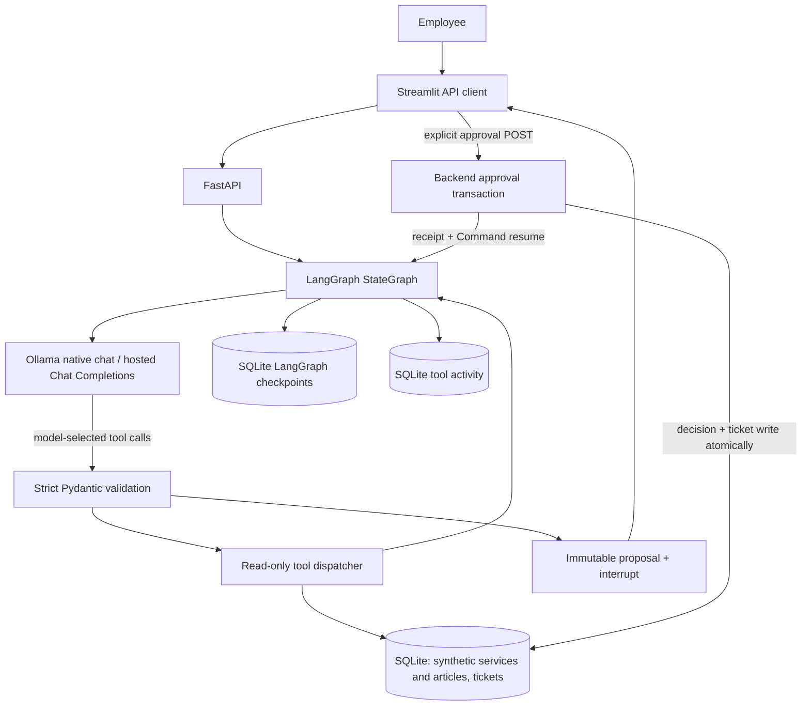

# ServiceDesk · LLM-powered IT Support Agent

A local-first portfolio application that investigates employee IT issues with **real LLM tool calling**, displays its evidence, and pauses ticket changes for explicit human approval. Enterprise services, incidents, troubleshooting records, and tickets are **simulated**. The model is real; there is no keyword chatbot or canned-answer fallback.

Python · LangGraph · FastAPI · Streamlit · SQLite · Ollama · optional hosted OpenAI-compatible chat

## Quick start

Requirements: Python 3.11–3.14 (3.13 recommended), [uv](https://docs.astral.sh/uv/getting-started/installation/), and [Ollama](https://docs.ollama.com/quickstart). The default is the tool-capable `qwen3:4b-instruct` with an 8K context, selected for an Ubuntu/WSL machine with 7.6 GiB RAM and CPU inference. Its quantized weights are approximately 2.5 GB; runtime and context need additional memory. See [the Ubuntu/WSL setup](docs/ollama-wsl.md) for the local installation, exact configuration, and real smoke-test procedure.

This WSL checkout uses the portable installation: use `bash scripts/ollama.sh serve` and `bash scripts/ollama.sh pull qwen3:4b-instruct` in place of the plain `ollama` commands below. The binary is deliberately not added to global PATH. To reproduce the portable installation, run `uv run python scripts/install_ollama.py` after dependency installation.

```bash
cp .env.example .env
uv sync --frozen --extra dev
ollama serve
```

If Ollama is already running as a service, skip `ollama serve`. In another terminal:

```bash
ollama pull qwen3:4b-instruct
uv run uvicorn support_agent.api:app --host 127.0.0.1 --port 8000 --reload --no-access-log
```

In a third terminal:

```bash
uv run streamlit run frontend/app.py --server.address 127.0.0.1
```

Open **http://localhost:8501**. API docs: **http://localhost:8000/docs**. Both databases and deterministic sample records initialize automatically on backend startup. No manual migrations or seed command are needed. The seed is idempotent and never resets user ticket edits.

Without uv: create a virtual environment, activate it, run `pip install -e '.[dev]'`, then run the same `uvicorn`, `streamlit`, and `pytest` commands without `uv run`. This uses the dependency ranges; `uv sync --frozen` uses the committed lockfile.

## Demo

```bash
curl -s http://localhost:8000/health
curl -s http://localhost:8000/health/model
uv run python scripts/demo.py
uv run python scripts/smoke_ollama.py
```

The script uses the real API and model, prints the conversation and tool activity, and prompts for an approval decision when needed. It never auto-approves. It exits with a clear error if a model call fails.

`scripts/smoke_ollama.py` is a separate read-only check: it asks a natural-language VPN question through the backend and fails unless Ollama requests a real status tool call and produces a final response after the tool executes. It prints the actual trace and saves it to ignored `data/smoke/ollama.json`; it never substitutes model responses or approves ticket changes.

Try these in the UI:

- “My VPN disconnects every few minutes. Check service status and find relevant troubleshooting.”
- “I am connected to corporate Wi-Fi but internal hostnames do not resolve. What should I check?”
- “My desktop email stopped syncing, but webmail works.”
- “My account is locked and I cannot use MFA.”
- “ExpenseHub shows HTTP 503. Investigate and prepare a high priority ticket.”
- “Retrieve ticket 1 and propose adding a note that the VPN still disconnects.”

For ticket changes, inspect the exact JSON fields, then click **Approve this change** or **Reject**. Sending “yes” in chat does not grant approval. Follow up after an approval or troubleshooting step; history and pending proposals survive a backend restart.

## Architecture



`support_agent/agent.py` defines a bounded model → tools → model cycle using `StateGraph`, `SqliteSaver`, `interrupt`, and `Command`. The LLM selects tools, arguments, and follow-up actions. Conditional graph edges handle safety boundaries and budgets; they do not classify user issues. Native Ollama `/api/chat` and hosted `/chat/completions` adapters share the same tool schemas. No external tools, vector database, RAG pipeline, MCP server, arbitrary SQL, or shell execution are present.

| Tool | Behavior |
| --- | --- |
| `get_system_status` | Deterministic simulated health and incident data for six services |
| `lookup_troubleshooting_steps` | Structured category query over 12 SQLite articles; deterministic symptom term ranking |
| `get_ticket` | Retrieve a simulated ticket and version |
| `create_ticket` | Propose a validated ticket; pause for human approval |
| `update_ticket` | Propose status, priority, or a note; pause for human approval |

## Approval and failure behavior

- The read dispatcher has no mutation implementation. A model tool call only stores a proposal, never a ticket write.
- The API accepts only a strict boolean decision, scoped to the conversation and current proposal ID. Clients cannot submit modified ticket fields or model-supplied approval grants. Extra fields are rejected.
- The backend reads immutable, revalidated proposal arguments and commits the decision, ticket write, and result receipt in one SQLite transaction. Duplicate decisions return 409; node replay reads the original receipt rather than writing again.
- Updates capture the ticket version. If another approval changes that ticket, a stale proposal fails without overwriting it. Proposals expire after 30 minutes by default; accepting an expired proposal records expiration without changing a ticket.
- Each mutation in a parallel model tool-call batch pauses separately. Rejecting one does not authorize the others. New chat messages are blocked while approval is pending.
- Durable graph checkpoints store the exact pause position. If the process stops after a write commits but before graph resumption, **Resume saved run** continues from the stored receipt. Resume cannot approve a pending proposal.
- Previously observed read results are reused when a paused tool batch replays, preserving the evidence and avoiding repeated service queries.
- Model errors are application notices with explicit error codes, never fabricated assistant answers. HTTP requests have timeouts and output limits; malformed JSON/tool calls fail safely. Tool argument errors and data failures become visible tool results for the model to handle.
- The backend enforces model-step and tool-call budgets for each turn, retained across approval resumes. A separate conversation history bound prevents unlimited context growth; start a new investigation when it is reached.
- All SQL values use bound parameters. No model-generated SQL or dynamic SQL identifiers are executed. Reference records are wrapped as untrusted data and the system prompt forbids following instructions in them. Prompt injection resistance is best effort; the approval/write boundary is enforced in code.
- Structured application logs contain only allow-listed operational metadata, never prompts, arguments, model outputs, credentials, or raw provider errors. HTTP access logging is disabled in the documented commands. Conversations and tool activity are deliberately stored locally and shown in the UI; do not enter secrets.

## Configuration

Copy `.env.example` to `.env`. Environment variables override the file.

| Variable | Default / meaning |
| --- | --- |
| `LLM_PROVIDER` | `ollama` or `openai` |
| `LLM_MODEL` | `qwen3:4b-instruct`; must support tools |
| `OLLAMA_BASE_URL` | `http://127.0.0.1:11434` |
| `OLLAMA_NUM_CTX` | `8192`, context tokens allocated per request |
| `OLLAMA_NUM_PREDICT` | `1024`, maximum generated tokens per request |
| `OLLAMA_NUM_THREAD` | `6`, CPU inference threads |
| `OLLAMA_THINK` | `auto` (omit the option), `true`, or `false`; instruct-only models should use `auto` |
| `OPENAI_BASE_URL` | `https://api.openai.com/v1`; base URL including `/v1` |
| `OPENAI_API_KEY` | Required for hosted mode; never sent to the frontend |
| `MODEL_TIMEOUT_SECONDS` | `180`, per model request |
| `DATABASE_PATH` | `data/support.db`, application data and approval receipts |
| `CHECKPOINT_PATH` | `data/checkpoints.db`, durable LangGraph state; must be a separate file |
| `MAX_MODEL_STEPS` / `MAX_TOOL_CALLS` | `6` / `8`, per turn including approval resumes |
| `MAX_HISTORY_MESSAGES` | `100`, start a new conversation at this bound |
| `APPROVAL_TTL_SECONDS` | `1800` |
| `LOG_LEVEL` | `INFO` |
| `API_BASE_URL` | `http://localhost:8000`, Streamlit server → backend |

Hosted example (edit `.env`; use a tool-capable model offered by your provider):

```dotenv
LLM_PROVIDER=openai
LLM_MODEL=gpt-4.1-mini
OPENAI_BASE_URL=https://api.openai.com/v1
OPENAI_API_KEY=your-private-key
```

Restart the backend after configuration changes. Hosted mode sends conversation and tool data to the configured provider. The adapter uses Chat Completions with `tools` and `max_completion_tokens`; providers with different API dialects may need adapter changes. The default Qwen3 instruct variant does not require a thinking option. `OLLAMA_THINK` allows explicit control for models that support it; unsupported options or incorrect model tags can cause errors. The adapter discards separate reasoning fields and strips leaked leading reasoning blocks from content, preserving only the actual final answer.

## Docker

Requires Docker Engine and Compose v2.24+. CPU inference is configured by default; GPU support requires host-specific Ollama configuration.

```bash
cp .env.example .env
docker compose up -d --build
docker compose exec ollama ollama pull qwen3:4b-instruct
curl -s http://localhost:8000/health/model
docker compose logs -f backend frontend
```

Open http://localhost:8501. Docker uses `http://ollama:11434` internally. Named volumes persist model downloads and both SQLite databases. `docker compose down` stops containers while keeping data. To use a host Ollama server instead, override `OLLAMA_BASE_URL` on the backend with a host-reachable URL; `localhost` inside a container is the container itself. Hosted provider variables are read from `.env` by the backend.

## Tests and checks

```bash
uv run pytest
uv run pytest --cov=support_agent --cov-report=term-missing
uv run ruff check .
uv run ruff format --check .
```

Tests use temporary SQLite files and scripted model responses or HTTP mock transports. They do not require Ollama, external credentials, or paid API calls. Coverage includes seeded tools, validation and SQL injection inputs, API errors, create/update approval and rejection, duplicate/cross-conversation decisions, expiry, optimistic ticket version checks, parallel proposals, persistence across restarts, recovery after a committed approval, orchestration, loop budgets, provider payloads, invalid output, timeouts, and unavailable servers.

Local verification on November 17, 2026 used Python 3.13.17, LangGraph 1.2.22, FastAPI 0.163.1, and Streamlit 1.67.0. The Streamlit integration tests exercise chat, tool activity, approval controls, and the resulting ticket write against the actual FastAPI app with a mocked model. Separate temporary-port checks verified both HTTP servers start, API documentation loads, conversations persist, and an unavailable provider produces an explicit application notice. The final Ubuntu/WSL setup also passed a real Ollama `qwen3:4b-instruct` round trip: two model invocations, one executed status tool, and a clean final answer in 51.46 seconds. See [the exact live trace](docs/ollama-smoke.md). The regression suite has 65 passing tests with 96% backend coverage. Hosted inference and Docker execution remain unverified.

## Scope and limitations

This is an enterprise-style **single-user local demo**, not a production helpdesk. There is no authentication, employee identity verification, per-user authorization, encryption at rest, remote helpdesk integration, live endpoint telemetry, or horizontal scaling. All local users can access the demo tickets and conversation list. Run one backend worker: graph invocations share a process lock and SQLite checkpoints. Docker ports bind to loopback; add authentication and a suitable persistence/concurrency design before remote deployment.

The UI polls activity during synchronous API requests; it does not stream model tokens. A restarted frontend can load saved conversations. Interrupted backend runs can be resumed, but a client losing its network response should refresh before retrying. Runtime provider availability checks only probe the model-list endpoint; they do not prove generation/tool calling works. Live model inference and Docker deployment must be tested separately on a machine with those services available.

Package/API references used during implementation: [LangGraph Graph API](https://docs.langchain.com/oss/python/langgraph/graph-api), [LangGraph persistence](https://docs.langchain.com/oss/python/langgraph/persistence), [Ollama tool calling](https://docs.ollama.com/capabilities/tool-calling), and [Chat Completions](https://developers.openai.com/api/reference/resources/chat). Exact resolved dependencies are recorded in `uv.lock`.
