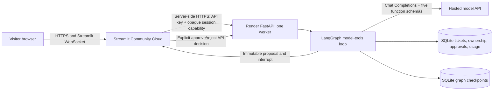

# Public portfolio deployment: Streamlit Community Cloud + Render

Prepared November 20; refreshed November 25, 2026. **Configuration and local verification are provided; no public service or real hosted inference has been verified.** Login, secrets, billing decisions, and publishing remain owner actions. See [the audit and test report](deployment-audit.md).

## Architecture and suitability



The browser never receives the shared backend API key or the model provider key. Streamlit calls FastAPI from its Python server. CORS is therefore empty by default; it is not needed for these calls. The backend verifies the API key and visitor capability before reading conversation state or accepting an approval.

Frontend entrypoint: `frontend/app.py`. Backend entrypoint: `python -m support_agent.serve`, which binds to `0.0.0.0:$PORT`, defaulting to 8000 locally, with one worker. The graph and repository use SQLite and a process lock. Do not add workers or replicas to this design.

**Suitable for:** a bounded, synthetic, anonymous portfolio sandbox with explicit ticket approvals. It is not an authenticated employee helpdesk, a production service, or an unlimited free inference endpoint.

## Cost and persistence choices

| Choice | Application behavior | Cost / limitations |
| --- | --- | --- |
| Community Cloud + Render Free + hosted provider's available free quota | `render.yaml` creates a fresh paired SQLite sandbox on each boot. Startup reseeds fixtures. UI warns that tickets/history may reset. | Hosting/inference may remain $0 within your actual account allowances. Free inference, eligibility, and continued capacity are not guaranteed. |
| Community Cloud + paid Render web service + persistent disk | Both SQLite files live on the same mounted disk. Backend restarts can preserve graph pauses, receipts, and tickets. | Paid compute plus disk storage; model API is separate. Review the current price before approving. |
| External Postgres service | Requires a repository migration AND a compatible PostgreSQL LangGraph checkpointer. | Not implemented. A DATABASE_URL alone does not migrate either SQLite database. External free tiers have their own limits. |

Render documents idle spin-down after 15 minutes, loss of free-instance local files on sleep/restart/redeploy, no free persistent disks, and monthly usage limits. Free Render Postgres expires after 30 days, so it is not a permanent free persistence solution. There are also outbound-traffic limits relevant to API calls. Do not add a keep-alive job to hide these constraints. [Render Free](https://render.com/docs/free), [persistent disks](https://render.com/docs/disks).

Render advertises paid Docker compute starting at $7/month; disk storage has separately listed pricing of $0.25/GB/month. Budget approximately $7.25/month for the smallest eligible paid service plus 1 GB disk, **subject to the current plan, storage minimum, taxes, overages, and provider pricing at checkout**. This is a planning estimate, not a billing quote. [Render Docker hosting](https://render.com/hosting/docker), [pricing](https://render.com/pricing).

### Why the default free profile is disposable

`DATABASE_PATH=/app/data/support.db` stores services, articles, conversations, approvals, tickets, activity, ownership, and model-call counters. `CHECKPOINT_PATH=/app/data/checkpoints.db` stores LangGraph history and interrupt position. Both are local SQLite files, with WAL sidecars. Losing either file breaks complete recovery; setting an environment variable does not make the filesystem persistent.

The free profile sets `RESET_DEMO_ON_START=true`. Each boot creates **both databases together** in a new `servicedesk-demo-*` subdirectory under `/app/data`. It never deletes or opens the configured legacy database files to reset them, and it exposes no public reset endpoint. The temporary pair is removed on clean shutdown. A new boot ID lets the frontend clear stale conversation state and display an explicit reset notice. Old proposal IDs cannot approve anything in the fresh sandbox.

On a free instance, treat all data and application usage counters as temporary. The UI labels this explicitly. If a reset races a request, use **New investigation**. A daily application budget can reset when its database is lost; configure provider-account limits as well. Never upload local/private databases to the cloud.

## Hosted model selection

The existing `LLM_PROVIDER=openai` adapter means **OpenAI-compatible Chat Completions**, not necessarily OpenAI's service. This profile uses:

```dotenv
LLM_PROVIDER=openai
OPENAI_BASE_URL=https://api.groq.com/openai/v1
LLM_MODEL=openai/gpt-oss-20b
HOSTED_REASONING_EFFORT=low
MAX_COMPLETION_TOKENS=1536
```

`OPENAI_API_KEY` must contain **your Groq API key**, stored only on Render. No OpenAI account is needed for this Groq configuration. Do not paste a key into this repository or a chat.

Groq documents this model for local function-tool calling and lists it in its rate-limit catalog. It does not support parallel tool use; this graph supports sequential tool requests, including the tools → model → next tool cycle. The five tools are ordinary local function tools, not Groq's hosted tools or built-in agent features. [Tool support](https://console.groq.com/docs/tool-use/overview), [API compatibility](https://console.groq.com/docs/openai), [supported models](https://console.groq.com/docs/models).

The adapter sends JSON tool schemas, carries normalized assistant tool-call IDs into subsequent tool messages, bounds output, and accepts standard Chat Completions responses. `max_completion_tokens` and the optional reasoning setting match Groq's documented API contract. This has been tested with a local scripted HTTP provider, **not a real Groq account**. [Groq API reference](https://console.groq.com/docs/api-reference).

Before deploying, sign into your provider account and confirm model access, free-plan eligibility, remaining limits, data handling, and whether billing is enabled. The catalog is not an account entitlement or guarantee. Current documented limits include request and token limits; your actual organization limits take precedence. The earlier Llama candidate is now marked enterprise-only in the model catalog and is not the default here. [Rate limits](https://console.groq.com/docs/rate-limits).

There is no fallback to Ollama or canned answers in cloud mode. Missing models, rejected credentials, quotas, malformed responses, and timeouts produce explicit application notices.

## Files prepared for deployment

| File | Purpose |
| --- | --- |
| `render.yaml` | Free Docker web-service blueprint, safe cloud defaults, explicit private secret inputs |
| `Dockerfile.backend` | Backend-only dependencies and source; non-root user; provider PORT launcher |
| `requirements-backend.txt` | Backend dependency export from `uv.lock`; excludes Streamlit |
| `frontend/requirements.txt` | Frontend dependency export; excludes FastAPI/LangGraph |
| `support_agent/serve.py` | `0.0.0.0`, validated PORT, one worker, access logging disabled |
| `.env.example` | Local Ollama defaults plus documented cloud settings; contains no secrets |
| `scripts/smoke_cloud.py` | API tool round trip and optional exact human-approved synthetic ticket |
| `scripts/smoke_groq.py` | Bounded read-only real Groq check in an authorized server runtime; no fallback or key-file loading |

Regenerate dependency exports after changing `uv.lock`:

```bash
uv run python scripts/export_requirements.py
```

Community Cloud searches the entrypoint directory before the repository root, so `frontend/requirements.txt` is intentional: it prevents selecting the backend-heavy root lockfile. The entrypoint adds the repository root to its module path, so source imports work without installing the backend package. Select **Python 3.13** in Cloud's advanced settings. [Dependency lookup](https://docs.streamlit.io/deploy/streamlit-community-cloud/deploy-your-app/app-dependencies).

## Owner step 1: review and publish the code

Review all pending changes, including the earlier portfolio/QA work in this checkout. No Git push was performed as part of this deployment preparation.

```bash
uv sync --frozen --extra dev
uv run ruff check .
uv run ruff format --check .
uv run pytest --cov=support_agent --cov-report=term-missing
uv run python scripts/audit_repository.py
git diff --check
git status --short
```

After your review, commit the intended source/configuration files and push to `SaadAlamDev/it-support-agent`:

```bash
git add .env.example .github/workflows/tests.yml .gitignore .dockerignore Dockerfile Dockerfile.backend compose.yaml render.yaml pyproject.toml uv.lock requirements-backend.txt README.md docs frontend support_agent scripts tests
git diff --cached --check
git diff --cached --stat
git diff --cached
git commit -m "Prepare separated cloud portfolio deployment"
git push origin main
```

Do not stage `.env`, `.streamlit/secrets.toml`, `data/`, runtime databases, `.local/`, logs, model weights, or private cloud credentials. A push to an already-connected hosting service can trigger a redeployment; review hosting auto-deploy settings first.

## Owner step 2: create the Render backend

Creating a web service publishes a public endpoint. This step requires your Render/GitHub login and explicit consent to publish.

1. Create or select a Render workspace and authorize access to this repository.
2. Choose a **Blueprint** and select the repository/branch containing `render.yaml`.
3. Review that the service uses **Free**, with no database or disk added. If Free is unavailable for your account/region, stop and review the required cost; do not silently select a paid plan.
4. Enter the two private secret inputs below, then approve creation. Use a password manager to generate the shared random key; do not put its value in shell history or a chat.
5. Wait for the build and `/healthz` check. Record the HTTPS `onrender.com` origin shown in your dashboard.

| Secret | Set where | Meaning |
| --- | --- | --- |
| `OPENAI_API_KEY` | Render only | Your hosted model provider key; for this profile, Groq |
| `SUPPORT_API_KEY` | Render and Streamlit only | The same random API access key, at least 32 characters, ideally 256-bit entropy |

The blueprint supplies these non-secret values:

| Setting | Value |
| --- | --- |
| Runtime / Dockerfile / context | Docker / `./Dockerfile.backend` / repository root |
| Instance plan | `free` |
| Startup command | Docker CMD: `python -m support_agent.serve` |
| Health-check path | `/healthz` |
| `APP_MODE` / `STORAGE_MODE` | `cloud` / `ephemeral` |
| `RESET_DEMO_ON_START` | `true`; fresh application/checkpoint pair each boot |
| Configured database / checkpoint path | `/app/data/support.db` / `/app/data/checkpoints.db`; reset mode uses a fresh paired subdirectory of `/app/data` |
| `LLM_PROVIDER` / `LLM_MODEL` | `openai` / `openai/gpt-oss-20b` |
| `OPENAI_BASE_URL` | `https://api.groq.com/openai/v1` |
| `HOSTED_REASONING_EFFORT` / `MAX_COMPLETION_TOKENS` | `low` / `1536` |
| `MODEL_TIMEOUT_SECONDS` | `30` per network operation |
| `MAX_MODEL_STEPS` / `MAX_TOOL_CALLS` | `4` / `6` per turn, including approval resumes |
| `MAX_HISTORY_MESSAGES` / `MAX_CONTEXT_CHARACTERS` | `40` / `16000` |
| `MAX_MODEL_CALLS_PER_DAY` | `100` across visitors, UTC day, reserved before inference |
| `MAX_CONVERSATIONS_PER_SESSION` / `MAX_CONVERSATIONS_TOTAL` | `5` / `100` until operator reset |
| `DEMO_ACTIONS_PER_MINUTE` / `DEMO_REQUESTS_PER_MINUTE` | `6` POSTs / `180` total requests per visitor |

Leave `PORT` to Render; the application reads its value. Leave `CORS_ALLOWED_ORIGINS` empty for Streamlit's server-side API calls. The exact optional origin format is `https://your-app.streamlit.app`, comma-separated for multiple origins. Wildcards and non-HTTPS cloud origins fail validation. API authentication remains required even for an allowed origin.

For manual Web Service creation rather than a Blueprint, choose Docker, use the same Dockerfile/context, set every value above plus both secrets, and retain one instance. Render's Dockerfile CMD is used automatically. Do not use the local Compose file as the Render entrypoint; it starts an unnecessary Ollama service. [Render port binding](https://render.com/docs/web-services#port-binding), [Blueprint fields](https://render.com/docs/blueprint-spec).

Public liveness check, which does not call the LLM or database:

```bash
curl -fsS https://YOUR-BACKEND.onrender.com/healthz
# Expected: {"status":"ok"}
```

`/health` and `/health/model` require authentication; `/health/model` only checks selected-model visibility, not inference. Cloud mode disables the interactive API documentation.

## Owner step 3: create the Streamlit frontend

1. Sign into Streamlit Community Cloud and connect the GitHub repository.
2. Choose **Create app**, repository `SaadAlamDev/it-support-agent`, your deployed branch, and **entrypoint `frontend/app.py`**.
3. Select **Python 3.13** in advanced settings.
4. Paste these root-level entries into the private **Secrets** editor, replacing placeholders:

   ```toml
   API_BASE_URL = "https://YOUR-BACKEND.onrender.com"
   SUPPORT_API_KEY = "REPLACE_WITH_THE_SAME_PRIVATE_RANDOM_KEY"
   ```

5. Review the public sharing setting, then explicitly approve deployment.
6. Open the resulting `streamlit.app` URL. A sleeping free backend may take about a minute to respond; the UI shows a connection spinner and offers **Retry connection**.

Do not put the model provider key in Streamlit. Do not wrap these settings in a TOML table: root-level Streamlit secrets are exported as environment variables, which this frontend reads. Do not disable Streamlit's CORS or XSRF protection. [Cloud deployment](https://docs.streamlit.io/deploy/streamlit-community-cloud/deploy-your-app/deploy), [secrets](https://docs.streamlit.io/develop/concepts/connections/secrets-management).

## Owner step 4: verify real inference and the public approval workflow

A green service, `/healthz`, or model-list probe does not establish successful inference. These steps remain unverified until you run them with your account/key.

Keep all real keys in hosting-provider secret settings. **Do not copy them into chat, local `.env` files, committed files, or browser code.** For the free deployment, perform acceptance through the public Streamlit UI: it already sends the access key from its server, so you need no local credentials.

Operator tools are also copied into the backend image. Only in an explicitly authorized server runtime with the keys already injected by the provider, the optional commands are:

```bash
# Read-only actual Groq -> graph -> status tool -> Groq check; max 3 model calls.
python -m scripts.smoke_groq
# Running backend API checks; the key remains in its existing runtime environment.
python -m scripts.smoke_cloud --api "http://127.0.0.1:${PORT:-8000}"
python -m scripts.smoke_cloud --api "http://127.0.0.1:${PORT:-8000}" --ticket-workflow
```

The provider-specific check uses the existing model adapter and a separate disposable API/SQLite sandbox, never a canned model, and never approves a ticket. API checks require actual tool evidence and a grounded answer; `--ticket-workflow` displays exact fields and prompts for a decision. Rejecting does not verify an approved write. Evidence is synthetic and saved under ignored `data/smoke/`. Do not run inference as an automatic health check or on every startup.

**Render Free has no interactive shell or one-off jobs. Do not upgrade merely to run these tools.** Use the public frontend acceptance below on Free. The tool commands are provided for authorized environments that already support them, not a requirement to pay for a shell. [Render Free restrictions](https://render.com/docs/free).

Verify in the **public frontend**:

1. Ask the VPN question and inspect the tool evidence plus final answer.
2. Request a synthetic ticket; confirm approval controls appear and no success receipt exists before a decision.
3. Reject it, then request another synthetic ticket and explicitly approve the displayed fields.
4. Confirm its completed tool receipt and ticket ID; ask the model to retrieve that ticket.
5. Open a new private browser session and verify it cannot see the first session's conversations or retrieve/update its ticket. Sample ticket 1 remains readable but cannot be updated in cloud mode.
6. Continue a multi-turn investigation. In the resettable free profile, restart and verify old conversations/proposals disappear, the reset notice appears, and the new sandbox starts from fixtures. If testing paid persistence instead, disable reset-on-start and verify a pending proposal survives the restart in the same still-connected UI session.
7. Record actual URLs, date, model, outputs, tool trace and receipt before calling deployment successful. Do not commit private headers or visitor capabilities in evidence.

The frontend session capability is stored in Streamlit's server session state, not a persistent login. A fresh/reconnected browser session or Streamlit restart can create a new sandbox; there is no account-based recovery of old investigations. Backend persistence preserves data, not a browser identity. Treat capability recovery as future work, not a production login feature.

## Optional: paid persistence with the existing SQLite implementation

This requires billing approval and changes to your Render service. It is intentionally not provisioned by the free blueprint.

1. Choose a paid web-service instance that supports persistent disks; review the price.
2. Add a persistent disk mounted at **`/var/data`**, with an appropriate size (start with 1 GB if the platform allows it).
3. Set:

   ```dotenv
   STORAGE_MODE=persistent
   RESET_DEMO_ON_START=false
   DATABASE_PATH=/var/data/support.db
   CHECKPOINT_PATH=/var/data/checkpoints.db
   ```

4. Ensure the mount is writable by container UID **10001**. If not, inspect platform mount ownership and explicitly grant that UID access; do not run the API as root or make the disk world-writable as a shortcut.
5. Deploy and perform the restart/pending-approval test above. Keep the same `SUPPORT_API_KEY`: its HMAC derives visitor ownership, so key rotation intentionally makes old session mappings inaccessible.
6. Keep one worker/instance. A persistent disk does not make SQLite suitable for a horizontally scaled deployment. Use consistent backups/snapshots of **both** databases; an arbitrary live file copy can miss WAL contents.

Changing the database paths initializes a fresh demo unless you deliberately migrate a consistent pair of existing files. Do not promise data migration or persistence merely because the setting says `persistent`; verify the actual mount and restart behavior. Render documents that disks require paid compute and have deployment/scaling constraints. [Disk documentation](https://render.com/docs/disks).

## Public-demo protections and remaining limits

- Fail-closed cloud settings require the shared API key, explicit storage mode, hosted credentials, an HTTPS provider origin without embedded credentials, and model-operation timeouts no greater than 60 seconds.
- Conversation listing, reads, activity, messages, resumes, and approvals are scoped to an HMAC-derived opaque visitor capability. The model cannot choose that capability. Ticket lookup/proposal/write checks enforce the same owner; the seeded sample is read-only.
- The graph still pauses before every ticket mutation. Approved fields, ticket version, expiry, decision and write receipt are checked in the backend and committed transactionally. There is no generic client ticket-write endpoint.
- Short request limits, bounded request bodies, one active investigation, conversation caps, bounded model context/output, and a persisted global daily call budget constrain abuse. Requests made through fresh visitor sessions still share the global model-call and conversation caps.
- This is not bot-proof, identity authentication, role-based authorization, DDoS mitigation, or a dollar-denominated spending guarantee. An abusive visitor can exhaust the demo. Free-instance resets also reset local counters; provider-account quotas/spend controls are essential.
- Model requests can fail at any provider quota. No automatic retries spend additional inference or repeat ticket decisions. Network-operation timeouts are not a strict whole-turn deadline. Context is character-bounded, not exact token accounting.
- The UI polls tool activity during requests rather than streaming tokens. Logs contain allow-listed metadata; conversation/tool content is stored in plaintext locally and sent to the hosted provider. Use only synthetic information.
- Current screenshots and earlier Ollama results document earlier local execution, not this cloud deployment. Hosted success and public browser rendering remain to be verified.

## Troubleshooting

For the “Cannot reach the model server. Start Ollama…” notice in a Groq deployment, follow the [provider-specific diagnostic guide](groq-diagnostics.md). The old wording is shared across providers and does not establish which provider ran.

| Symptom | Check |
| --- | --- |
| Backend fails validation | Set both private keys, APP_MODE=cloud, STORAGE_MODE explicitly, hosted HTTPS URL, timeout <=60. Do not paste the error's environment values publicly. |
| Frontend 401 | Shared key differs or is missing; use root-level Streamlit secrets, then restart the frontend. Session capability is added automatically. |
| Frontend cannot connect / free cold start | Use the exact HTTPS backend origin; wait and retry. Check Render startup logs and `/healthz`. |
| Missing model / 401 from provider | Confirm the key belongs to the configured provider and selected model is visible to that account. The `openai` adapter name does not make a Groq key an OpenAI key. |
| 429 or daily_limit | Read the application notice. Per-session request, global capacity, application daily calls, and provider token/request quotas are distinct; do not blindly retry. |
| context_limit or invalid_model_output | Start a new investigation or review model/output limits. A truncated response is not treated as success. |
| Old conversation 404 after sleep/redeploy | Expected with ephemeral storage. Use New investigation; do not claim data survived. A new browser session also has a new capability. |
| Ticket 1 update denied | Intentional cloud protection: the shared fixture is read-only. Create and explicitly approve your own synthetic ticket. |
| Approved receipt exists but model summary fails | The ticket is already committed. Inspect saved activity and refresh; do not approve another proposal to retry the summary. |
| Streamlit tries to install backend packages | Confirm the deployed commit contains `frontend/requirements.txt` and entrypoint is `frontend/app.py`. |

## Authorization still needed

The owner must authorize GitHub/hosting account connections, choose free vs paid persistence, create/configure private keys in the provider consoles, approve each public service creation, and explicitly approve the synthetic ticket in the real smoke/UI test. No account was logged into, no credential was requested from you or displayed, and no cloud resource changed during preparation. Do not call the deployment successful until the public frontend, backend, real hosted tool round trip, and approved ticket receipt have all been verified.
